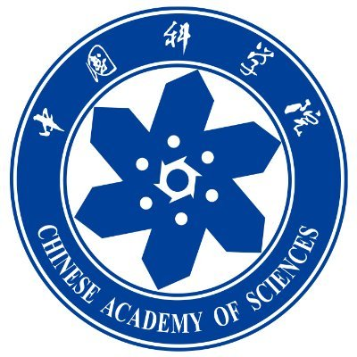

  <section class="hero" id="about-me" aria-labelledby="hero-title">
    

      <h1 id="hero-title">Churan Zhi</h1>
      

        I’m currently a Software Engineer on the <strong><a href="https://gemini.google/overview/gemini-in-chrome/" target="_blank" rel="noopener noreferrer">Gemini in Chrome</a></strong> team at <strong>Google</strong>.
        I build <strong>browser-use</strong> and <strong>computer-use</strong> capabilities, as well as the core <strong>agent infrastructure</strong> powering <strong>Gemini Chat</strong> and <strong>Gemini Spark</strong>.
        My research interests focus on enabling AI agents to navigate the web and operate computers with <strong>lower latency and higher reliability</strong>, and on building <strong>scalable, efficient agent infrastructure</strong>.
      

      

        Prior to joining Google, I received my M.S. in Computer Science at <strong>UC San Diego</strong>, advised by <a href="https://cseweb.ucsd.edu/~jmcauley/" target="_blank" rel="noopener noreferrer">Prof. Julian McAuley</a>, where I worked on <strong>agent memory</strong>, <strong>trustworthy AI</strong>, and <strong>MoE post-training</strong>.
        Earlier, I earned my B.S. at <strong>Beijing Jiaotong University</strong> and researched <strong>domain adaptation</strong> as a Research Assistant in the <a href="https://vipl.ict.ac.cn/en/" target="_blank" rel="noopener noreferrer">VIPL group</a> at the Institute of Computing Technology, Chinese Academy of Sciences, advised by <a href="https://scholar.google.com/citations?hl=zh-CN&amp;user=iBt9uHUAAAAJ&amp;view_op=list_works&amp;sortby=pubdate" target="_blank" rel="noopener noreferrer">Junbao Zhuo</a> and <a href="https://scholar.google.com/citations?user=h-JxBSYAAAAJ&amp;hl=zh-CN" target="_blank" rel="noopener noreferrer">Shuhui Wang</a>.
        I also interned at <strong>Amazon</strong>, <strong>Microsoft</strong>, and <strong>Xiaomi</strong>.
      

      

        
Reach out

        

          <a class="contact-link" href="mailto:crleozhi@gmail.com" aria-label="Email Churan Zhi" title="Email">
            <i class="fas fa-envelope" aria-hidden="true"></i>
          </a>
          <a class="contact-link" href="https://www.linkedin.com/in/churan-zhi/" target="_blank" rel="noopener noreferrer" aria-label="Churan Zhi on LinkedIn" title="LinkedIn">
            <i class="fab fa-linkedin-in" aria-hidden="true"></i>
          </a>
          <a class="contact-link" href="https://github.com/churanz" target="_blank" rel="noopener noreferrer" aria-label="Churan Zhi on GitHub" title="GitHub">
            <i class="fab fa-github" aria-hidden="true"></i>
          </a>
          <a class="contact-link" href="https://scholar.google.com/citations?user=jkCtltsAAAAJ&amp;hl=en" target="_blank" rel="noopener noreferrer" aria-label="Churan Zhi on Google Scholar" title="Google Scholar">
            <i class="fas fa-graduation-cap" aria-hidden="true"></i>
          </a>
        

      

    

    <figure class="hero__portrait">
      

        
      

    </figure>
  </section>

  <section class="content-section" id="publications" aria-labelledby="publications-title">
    <header class="section-heading">
      <h2 id="publications-title"><i class="fas fa-book-open" aria-hidden="true"></i>Publications</h2>
    </header>
    
* Equal contribution.

    

      <article class="publication-card" id="memoryarena">
        

          <h3>MemoryArena: Benchmarking Agent Memory in Interdependent Multi-Session Agentic Tasks</h3>
          
Zexue He*, Yu Wang*, <strong>Churan Zhi*</strong>, Yuanzhe Hu*, Tzu-Ping Chen*, Lang Yin*, Ze Chen, Tong Arthur Wu, Siru Ouyang, Zihan Wang, Jiaxin Pei, Julian McAuley, Yejin Choi, Alex Pentland

          

            ICML 2026
            <a href="https://arxiv.org/abs/2602.16313" target="_blank" rel="noopener noreferrer">[Paper]</a>
            <a href="https://memoryarena.github.io/" target="_blank" rel="noopener noreferrer">[Website]</a>
            
            
            
          

        

      </article>

      <article class="publication-card">
        

          <h3>Confusing Pair Correction Based on Category Prototype for Domain Adaptation under Noisy Environments</h3>
          
<strong>Churan Zhi</strong>, Junbao Zhuo, Shuhui Wang

          
AAAI 2024<a href="https://ojs.aaai.org/index.php/AAAI/article/view/29650" target="_blank" rel="noopener noreferrer">[Paper]</a>

        

      </article>

      <article class="publication-card">
        

          <h3>BiasFreeBench: A Benchmark for Mitigating Bias in Large Language Model Responses</h3>
          
Xin Xu, Xunzhi He*, <strong>Churan Zhi*</strong>, Ruizhe Chen, Julian McAuley, Zexue He

          
ICLR 2026<a href="https://arxiv.org/abs/2510.00232" target="_blank" rel="noopener noreferrer">[Paper]</a>

        

      </article>

      <article class="publication-card">
        

          <h3>DenseMixer: Improving MoE Post-Training with Precise Router Gradients</h3>
          
Feng Yao, Junxia Cui, Ruohan Zhang, Liyuan Liu, Shibo Hao, Li Zhang, Chengyu Dong, <strong>Churan Zhi</strong>, Shuohang Wang, Yelong Shen, Jianfeng Gao, Jingbo Shang

          
EMNLP 2026<a href="https://fengyao.notion.site/moe-posttraining" target="_blank" rel="noopener noreferrer">[Paper]</a>

        

      </article>

      <article class="publication-card">
        

          <h3>H3M-SSMoEs: Hypergraph-based Multimodal Learning with LLM Reasoning and Style-Structured Mixture of Experts</h3>
          
Peilin Tan, Liang Xie, <strong>Churan Zhi</strong>, Dian Tu, Chuanqi Shi

          
AAAI 2027<a href="https://arxiv.org/abs/2510.25091" target="_blank" rel="noopener noreferrer">[Paper]</a>

        

      </article>

      <article class="publication-card" id="mixweaver">
        

          <h3>MixWeaver: Stem-aware Automatic DJ Transition Generation via Structured Discrete Optimization</h3>
          
Xuran Zhou, Xunyi Jiang, <strong>Churan Zhi</strong>, Junda Wu, Julian McAuley

          
ISMIR 2026<a href="https://ismir2026program.ismir.net/poster_428.html#details" target="_blank" rel="noopener noreferrer">[Paper]</a>

        

      </article>
    

  </section>

  <section class="content-section" id="experience" aria-labelledby="experience-title">
    <header class="section-heading">
      <h2 id="experience-title"><i class="fas fa-briefcase" aria-hidden="true"></i>Work Experience</h2>
    </header>

    

      <article class="experience-card">
        
Apr 2026 — Present

        

        

          

            <h3>Google</h3>
            
Software Engineer · Full-time

          

          

            
Mountain View, CA

            
<a href="https://gemini.google/overview/gemini-in-chrome/" target="_blank" rel="noopener noreferrer">Gemini in Chrome</a>

          

        

      </article>

      <article class="experience-card">
        
Jun 2025 — Sep 2025

        

        

          

            <h3>Amazon</h3>
            
Software Engineer Intern

          

          

            
Seattle, WA

            
Store: Tax Engine

          

        

      </article>

      <article class="experience-card">
        
May 2024 — Jul 2024

        

        

          

            <h3>Microsoft</h3>
            
Software Engineer Intern

          

          

            
Beijing, China

            
Bing: Search &amp; Distribution

          

        

      </article>

      <article class="experience-card">
        
Feb 2024 — Apr 2024

        

        

          

            <h3>Xiaomi</h3>
            
Machine Learning Engineer Intern

          

          

            
Beijing, China

            
In-Vehicle AI Agents

          

        

      </article>

    

  </section>
  <section class="content-section" id="research-experience" aria-labelledby="research-experience-title">
    <header class="section-heading">
      <h2 id="research-experience-title"><i class="fas fa-flask" aria-hidden="true"></i>Research Experience</h2>
    </header>

    

      <article class="research-row">
        
        

          

            <h3>University of California, San Diego</h3>
            
Nov 2024 – Mar 2026

          

          
Research Assistant · San Diego, CA

          
Trustworthy AI and Agent Memory

          
<strong>Advisor:</strong> <a href="https://cseweb.ucsd.edu/~jmcauley/" target="_blank" rel="noopener noreferrer">Julian McAuley</a>

        

      </article>

      <article class="research-row">
        
        

          

            <h3>Institute of Computing Technology, Chinese Academy of Sciences</h3>
            
Dec 2021 – Feb 2024

          

          
Research Assistant · Beijing, China

          
Visual Information Processing and Learning (<a href="https://vipl.ict.ac.cn/en/" target="_blank" rel="noopener noreferrer">VIPL</a>) Research Group: Transfer Learning and Domain Adaptation

          
<strong>Advisors:</strong> <a href="https://scholar.google.com/citations?hl=zh-CN&amp;user=iBt9uHUAAAAJ&amp;view_op=list_works&amp;sortby=pubdate" target="_blank" rel="noopener noreferrer">Junbao Zhuo</a>, <a href="https://scholar.google.com/citations?user=h-JxBSYAAAAJ&amp;hl=zh-CN" target="_blank" rel="noopener noreferrer">Shuhui Wang</a>

        

      </article>
    

  </section>

  <section class="content-section content-section--last" id="education" aria-labelledby="education-title">
    <header class="section-heading">
      <h2 id="education-title"><i class="fas fa-graduation-cap" aria-hidden="true"></i>Education</h2>
    </header>

    

      <article class="education-row">
        
M.S.

        

          
2024 – 2026

          <h3>University of California, San Diego</h3>
          
M.S. in Computer Science · San Diego, CA

          
<strong>Advisor:</strong> <a href="https://cseweb.ucsd.edu/~jmcauley/" target="_blank" rel="noopener noreferrer">Julian McAuley</a>

          
<strong>Teaching Assistant</strong> · CSE 153/253: Machine Learning for Music · Mar 2025 – Jun 2025

        

        
      </article>

      <article class="education-row">
        
B.S.

        

          
2020 – 2024

          <h3>Beijing Jiaotong University</h3>
          
B.S. in Computer Science · Beijing, China

          
<strong>Advisors:</strong> <a href="https://scholar.google.com/citations?hl=zh-CN&amp;user=iBt9uHUAAAAJ&amp;view_op=list_works&amp;sortby=pubdate" target="_blank" rel="noopener noreferrer">Junbao Zhuo</a>, <a href="https://scholar.google.com/citations?user=h-JxBSYAAAAJ&amp;hl=zh-CN" target="_blank" rel="noopener noreferrer">Shuhui Wang</a>

        

        
      </article>
    

  </section>

